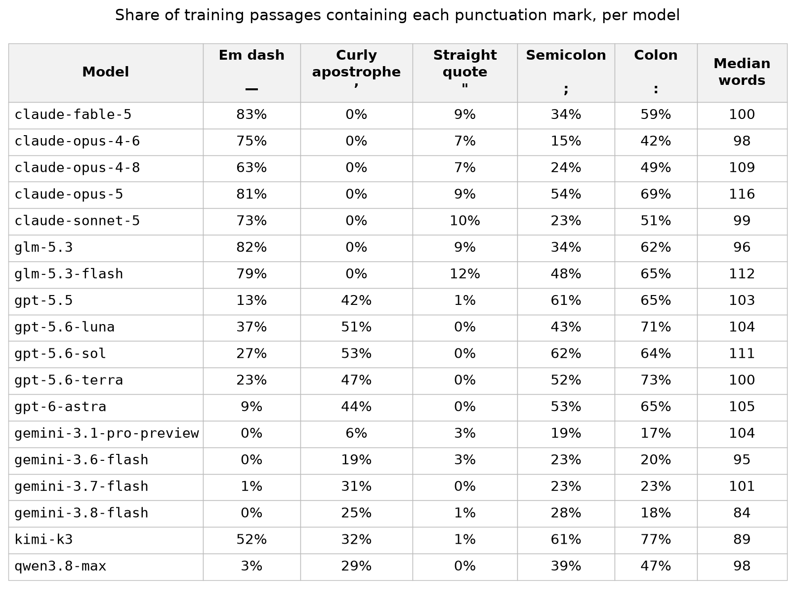
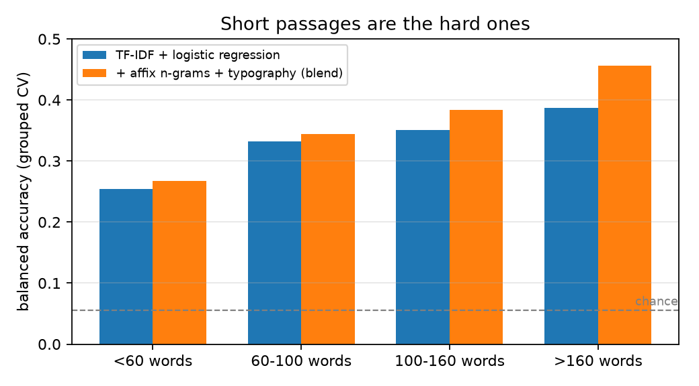

# What the punctuation already tells you about the 18 models (and what it can't)

- Topic ID: 750664
- Author: Masood Ahmed
- Author tier: EXPERT
- URL: /competitions/name-that-llm/discussion/750664
- Posted: 2026-10-19T12:29:30.421553700Z
- Updated: 2026-11-02T09:45:05.153333300Z
- Votes: 20
- Replies: 10
- Remote list status: listed
- Remote list checked: 2026-11-18T09:01:53+00:00

## Content

I spent my first day on a data audit instead of training anything, and honestly the punctuation table explains most of what makes this competition hard. Posting the numbers in case they save someone a day.

A few things I noticed:

Lab is almost readable from two columns. Claude and GLM love em dashes and only ever use straight quotes. GPT and Gemini are the opposite: curly apostrophes everywhere, straight quotes basically never. Gemini barely uses em dashes at all.

GLM looks like Claude on every single marker here. Which is probably why glm-5.3 and glm-5.3-flash are two of my three worst classes right now (recall 0.17 and 0.19). Punctuation can't separate them from Claude, so that has to come from word choice.

Siblings are flat. Inside OpenAI the em dash rate goes from 9% (gpt-6-astra) to 37% (gpt-5.6-luna), which is something, but not much. Inside Gemini the four models mostly differ on how often they use a curly apostrophe (6% to 31%). Everything else about the sibling problem lives somewhere other than punctuation.

On the error split: a plain TF-IDF (char 1-5 + word 1-2, lowercase=False) with logistic regression, validated with StratifiedGroupKFold on prompt_id, gets 0.345 balanced accuracy (CI 0.33 to 0.36, bootstrapped over prompts). If you only ask "did it get the lab right", the same predictions score 0.58, and 55% of all mistakes are the right lab, wrong model. I then added a char_wb affix view and about 80 hand-made typography and rhythm features (dash/quote variants, sentence length stats, type-token ratio) in a LightGBM and blended the three. That gets to 0.372 (CI 0.36 to 0.39), lab accuracy 0.61... and the within-lab share of errors actually goes UP to 58%. So the classical stuff is solving the easy lab problem and barely scratching the sibling problem.

Length matters more than I expected. Under 60 words the blend is at 0.27, over 160 words it's at 0.46. If your CV looks healthy, it's worth checking it by length bucket before trusting it.

Two things that did not work, since those are useful too. First-word habits aren't a tell here: every lab opens with "the" or "in" most of the time, so openers don't carry the signal some papers report. And the punctuation "rules" that look absolute in train (Gemini never using em dashes, Claude never using curly quotes) are exactly the kind of thing that breaks on freshly generated text, so I'm treating them as features to learn alongside everything else, not as hard filters.

For what it's worth, the top LightGBM features were comma rate, type-token ratio, word-length std, sentence-length std, capitalised-word rate and long-word rate. Vocabulary richness and rhythm, not any one mark.

All of this is grouped CV on the public train set only, 5 folds x 3 seeds, no external data. Happy to be corrected on any of it.

## Replies

### HALX2158

- Message ID: 3541324
- Author tier: CONTRIBUTOR
- Posted: 2026-10-19T22:23:36.803Z
- Votes: 0
- Thank you: False
- Remote list status: listed
- Remote list checked: 2026-11-16T16:23:33+00:00

Nice audit. We see the same in our heatmap: em-dash rates are 79-82% for the two GLM models and 63-83% for the Claude models, while all four Gemini models are at 0-1%. One more thing that matters if you add external data: proxy-generated Gemini text often has em dashes (13-43% depending on reasoning settings, per the dataset notes of lucasboesen and dophuchung), so the "Gemini never uses em dashes" rule in train can flip.

#### Masood Ahmed

- Message ID: 3541330
- Parent message ID: 3541324
- Author tier: EXPERT
- Posted: 2026-10-19T22:37:37.190Z
- Votes: 1
- Thank you: False
- Remote list status: listed
- Remote list checked: 2026-11-16T16:23:33+00:00

haha absolutely, i was getting some external data and got em dashes in Gemini models.. its a rollercoater ( these were my intitial findings with the provided train data ) but apparently its gonna come down to words choosing plus pattern of sentence creation of models.

### Nikhil Agrawal

- Message ID: 3541499
- Author tier: CONTRIBUTOR
- Posted: 2026-10-20T07:35:30.397Z
- Votes: 1
- Thank you: False
- Remote list status: listed
- Remote list checked: 2026-11-16T16:23:33+00:00

Same analysis here 
there was one other thing if taken all examples and then tested against all others even with the most basic of classification of logistic regression gemini tends to be the most separable of all be it the em-dashes or the passage lengths on the other hand claude and glm are confused with each other (the distillation news may be true for glm 😂)

#### Masood Ahmed

- Message ID: 3541663
- Parent message ID: 3541499
- Author tier: EXPERT
- Posted: 2026-10-20T16:02:04.380Z
- Votes: 1
- Thank you: False
- Remote list status: listed
- Remote list checked: 2026-11-16T16:23:33+00:00

Hahaha, there is no "maybe" 😶

#### Starright

- Message ID: 3544896
- Parent message ID: 3541499
- Author tier: CONTRIBUTOR
- Posted: 2026-10-26T13:35:37.930Z
- Votes: 1
- Thank you: False
- Remote list status: listed
- Remote list checked: 2026-11-16T16:23:33+00:00

What if some reply of the glm and kimi route to the claude? This might be the false data from the dataset (some report might confirm this)

##### Nikhil Agrawal

- Message ID: 3545628
- Parent message ID: 3544896
- Author tier: CONTRIBUTOR
- Posted: 2026-10-27T16:44:47.053Z
- Votes: 0
- Thank you: False
- Remote list status: listed
- Remote list checked: 2026-11-16T16:23:33+00:00

false data in the sense the paragraph was generated by claude itself and marked with glm and kimi?

##### Starright

- Message ID: 3545932
- Parent message ID: 3544896
- Author tier: CONTRIBUTOR
- Posted: 2026-10-28T01:45:08.163Z
- Votes: 0
- Thank you: False
- Remote list status: listed
- Remote list checked: 2026-11-16T16:23:33+00:00

Even with the api call, we do not know whether glm or kimi giving you its own model or claude. haha. Perhaps

#### Starright

- Message ID: 3544901
- Parent message ID: 3541499
- Author tier: CONTRIBUTOR
- Posted: 2026-10-26T13:39:48.297Z
- Votes: 1
- Thank you: False
- Remote list status: listed
- Remote list checked: 2026-11-16T16:23:33+00:00

And if the problem is only from the distillation, conceptually, this is more easy to figure out groups and some head might deal with this, however, even if current participant provide somewhat large scale of data, the transformer itself (both customized and the qween or other used one) still hard to figure out them

##### Nikhil Agrawal

- Message ID: 3545629
- Parent message ID: 3544901
- Author tier: CONTRIBUTOR
- Posted: 2026-10-27T16:46:06.697Z
- Votes: 0
- Thank you: False
- Remote list status: listed
- Remote list checked: 2026-11-16T16:23:33+00:00

true ig i am still very new to the whole ai world of attention heads and other things working things out

### bosprimigenious

- Message ID: 3548516
- Author tier: CONTRIBUTOR
- Posted: 2026-11-02T09:45:05.153Z
- Votes: 0
- Thank you: False
- Remote list status: listed
- Remote list checked: 2026-11-16T16:23:33+00:00

Hi Masood, your prompt-grouped audit, length-bucket checks, and analysis of within-family errors are very relevant to the gaps in my current approach. I'm recruiting two complementary teammates for a three-person Name That LLM team using free compute only; my current public score is 0.349 with a CPU text/style baseline. Would you be interested in contributing data auditing, validation and ensemble experiments alongside an NLP-training teammate? If you're open to it, could you confirm whether you're still competing solo, the time you could commit, and whether free-compute-only collaboration works for you? I'd keep competition code and artifacts private within an officially formed team.
