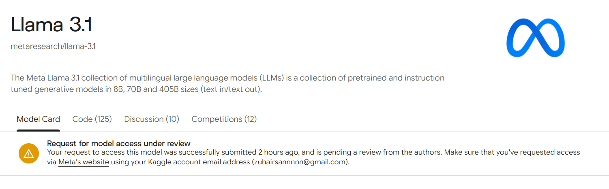

# How to request access llama-3.1

- Topic ID: 751910
- Author: SANNNNN
- Author tier: EXPERT
- URL: /competitions/name-that-llm/discussion/751910
- Posted: 2026-10-23T03:46:39.975036300Z
- Updated: 2026-11-01T12:39:21.190Z
- Replies: 2
- Remote list status: listed
- Remote list checked: 2026-11-16T16:36:37+00:00

## Content

i have requested the model acess but its still pending. it said to request on Meta website as well, i signed up using same email acc , but how to request from there? anyone knows

## Replies

### latentgenius

- Message ID: 3546890
- Author tier: CONTRIBUTOR
- Posted: 2026-10-29T22:27:54.773Z
- Votes: 0
- Thank you: False
- Remote list status: listed
- Remote list checked: 2026-11-16T16:23:36+00:00

Same issue here. My Kaggle request for Llama 3.1 is pending, but Meta's download form seems to be gone. The "Meta's website" link in the access banner (ai.meta.com/resources/models-and-libraries/llama-downloads), llama.com/llama-downloads, and dev.meta.ai/llama/llama-downloads all redirect to the Muse homepage, so there's no form to submit. @Kaggle staff: is there another way to get approved, or will pending requests be reviewed without the Meta form?

### HALX2158

- Message ID: 3548125
- Author tier: CONTRIBUTOR
- Posted: 2026-11-01T12:39:21.190Z
- Votes: 0
- Thank you: False
- Remote list status: listed
- Remote list checked: 2026-11-16T16:23:36+00:00

Sharing what happened in my case. Meta's download links also sent me to the Muse site. I then submitted the access form on the Hugging Face page for meta-llama/Llama-3.1-8B and received an email saying the request was accepted. On 2026-11-01, `metaresearch/llama-3.1/Transformers/8b/2` on Kaggle stopped returning 403 for me, and I scored a notebook with it. I can't say which step cleared the Kaggle access.
