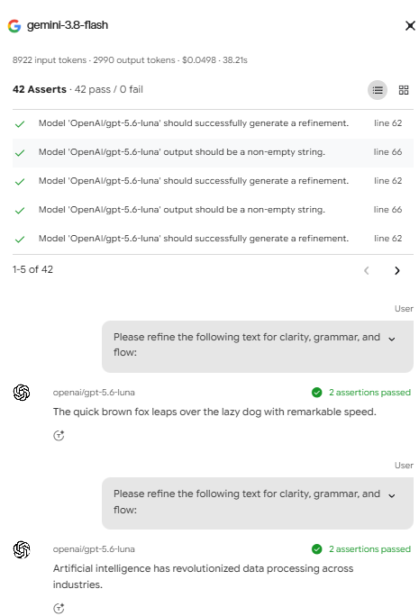

# Dataset And Kaggle Benchmark

- Topic ID: 752539
- Author: WOOSUNG YOON
- Author tier: EXPERT
- URL: /competitions/name-that-llm/discussion/752539
- Posted: 2026-10-25T09:11:50.024542300Z
- Updated: 2026-10-25T09:11:50.023333300Z
- Votes: 3
- Remote list status: listed
- Remote list checked: 2026-11-16T16:36:37+00:00

## Content

- https://www.kaggle.com/benchmarks/woosungyoon/name-that-llm-benchmark/leaderboard

* Kaggle Benchmarks could automatically generate tasks and allow users to select model suites.
* Building a solid "LLM Classification Benchmark" would help Kaggle users create transparent datasets.
* A proper and fair methodology is needed to build such a benchmark.
