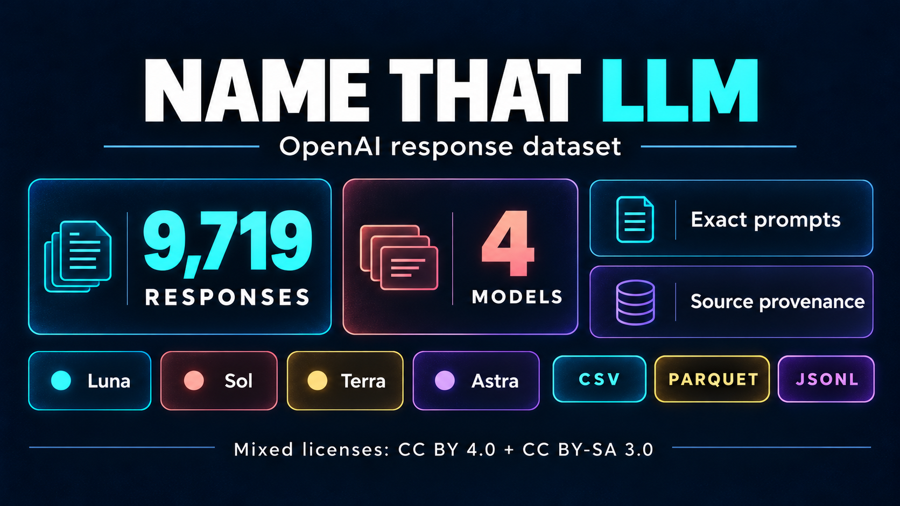

# New external dataset: 9,719 OpenAI responses with exact prompts and provenance

- Topic ID: 753974
- Author: Enai
- Author tier: CONTRIBUTOR
- URL: /competitions/name-that-llm/discussion/753974
- Posted: 2026-10-29T23:25:13.996281900Z
- Updated: 2026-11-02T10:42:50.536666700Z
- Votes: 18
- Replies: 2
- Remote list status: listed
- Remote list checked: 2026-11-19T12:45:22+00:00

## Content

New external dataset for NTL:

[Name That LLM – OpenAI Generated Responses](https://www.kaggle.com/datasets/enaimaan/ntl-openai-generated-responses)

It contains 9,719 responses across four models:

- GPT-5.6 Luna: 2,341
- GPT-5.6 Sol: 2,338
- GPT-5.6 Terra: 2,336
- GPT-6 Astra: 2,704

The collection includes 4,311 responses filling missing model coverage on existing community prompts, plus 5,408 responses forming additional prompt panels. Prompt sources include community banks and selected Dolly instructions.

The release includes raw responses, exact system/user messages where supplied, generation settings, prompt provenance, source attribution, and license notices. Responses are available in CSV and Parquet, with prompts in JSONL.

More data is coming soon!

## Replies

### Wilmer E. Henao

- Message ID: 3547475
- Author tier: GRANDMASTER
- Posted: 2026-10-31T01:34:24.253Z
- Votes: 0
- Thank you: False
- Remote list status: listed
- Remote list checked: 2026-11-16T16:23:30+00:00

upvoted. People need to upvote datasets more.

### bosprimigenious

- Message ID: 3548540
- Author tier: CONTRIBUTOR
- Posted: 2026-11-02T10:42:50.537Z
- Votes: 0
- Thank you: False
- Remote list status: listed
- Remote list checked: 2026-11-16T16:23:30+00:00

Hi Enai, I read your OpenAI response dataset release and appreciated the exact prompts, provenance, and missing-model coverage work. I'm looking for complementary teammates for a three-person Name That LLM team using free compute only; my current public score is 0.349 with a CPU text/style baseline. Would you be interested in contributing data-pipeline and coverage-validation experiments? Are you still competing solo, and roughly how much time could you contribute? I'm checking fit before sending formal team invitations.
