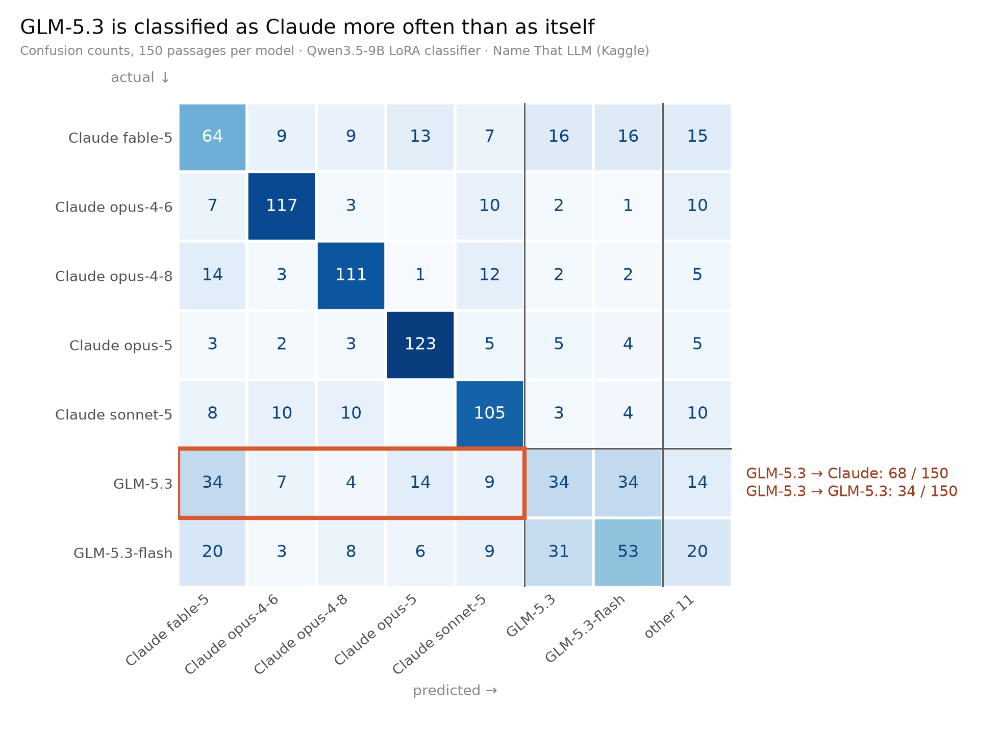
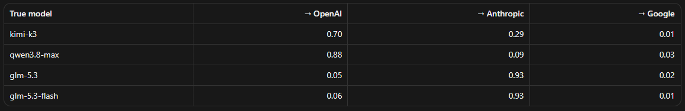

# My classifier thinks GLM-5.3 is more Claude than GLM

- Topic ID: 755314
- Author: AyoGG
- Author tier: MASTER
- URL: /competitions/name-that-llm/discussion/755314
- Posted: 2026-11-03T07:38:06.530458200Z
- Updated: 2026-11-14T08:24:36.906666700Z
- Votes: 10
- Replies: 6
- Remote list status: listed
- Remote list checked: 2026-11-19T12:45:20+00:00

## Content

Trained a 9B classifier to tell 18 LLMs apart.
Gemini only gets confused with Gemini. GPT only with GPT.
GLM-5.3? Classified as Claude more often than as GLM-5.3 itself (68 vs 34 out of 150).
Family resemblance is a hell of a thing.

## Replies

### tingyi

- Message ID: 3549231
- Author tier: EXPERT
- Posted: 2026-11-03T07:40:43.373Z
- Votes: 2
- Thank you: False
- Remote list status: listed
- Remote list checked: 2026-11-18T09:02:19+00:00

maybe GLM5.3 API will rerouter to fable5?

### somerandomguy

- Message ID: 3550042
- Author tier: CONTRIBUTOR
- Posted: 2026-11-04T17:48:06.763Z
- Votes: 4
- Thank you: False
- Remote list status: listed
- Remote list checked: 2026-11-18T09:02:19+00:00

Anthropic claims their model being distilled, so yeah that explains some of that.

### hsiaosuan

- Message ID: 3550370
- Author tier: EXPERT
- Posted: 2026-11-05T06:37:43.387Z
- Votes: 1
- Thank you: False
- Remote list status: listed
- Remote list checked: 2026-11-18T09:02:19+00:00

XD same observations for mee as well 
Two non-exclusive possibilities
1. GLM distills claude
2. GLM routes some requests to claude

IMO both are very possible

### Subhranil Paul

- Message ID: 3550388
- Author tier: CONTRIBUTOR
- Posted: 2026-11-05T07:19:34.257Z
- Votes: 1
- Thank you: False
- Remote list status: listed
- Remote list checked: 2026-11-18T09:02:19+00:00

https://www.anthropic.com/research/glm-5-3-and-the-spread-of-advanced-cyber-capabilities

### jp@sightsource

- Message ID: 3554009
- Author tier: CONTRIBUTOR
- Posted: 2026-11-12T14:09:00.693Z
- Votes: 0
- Thank you: False
- Remote list status: listed
- Remote list checked: 2026-11-18T09:02:19+00:00

Z.AI has marketed GLM for use inside coding tools built around Claude, with an Anthropic-compatible API. Tuning a model to behave like a drop-in replacement for Claude would push its style toward Claude’s, whether or not Claude was distilled to create its weights.

### Hotson Honet

- Message ID: 3554954
- Author tier: EXPERT
- Posted: 2026-11-14T08:24:36.907Z
- Votes: 2
- Thank you: False
- Remote list status: listed
- Remote list checked: 2026-11-18T09:02:19+00:00

feeling bad for google, no frontier open weights model uses it 😂. 

What I have done is trained a model specific to closed weights model and performed the inference on the open weights model. This is the normalized confusion matrix (across rows) for it. This is the main reason why throwing more money on data generation is giving folks a good score as their model is seeing more examples of open weights model to build an segregation criteria.

The dataset I have used is shown here is from the provided training dataset.
